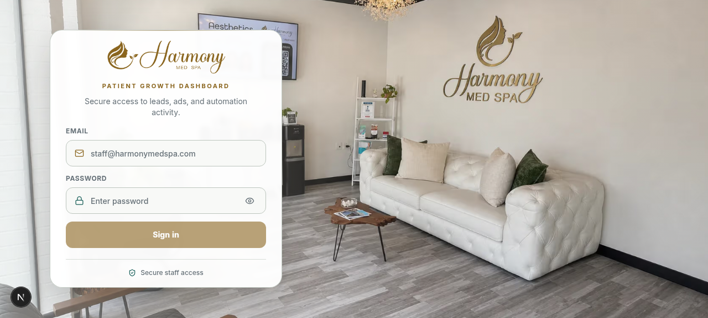
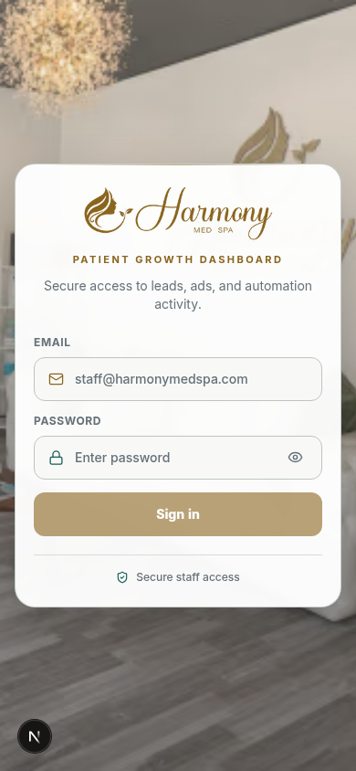
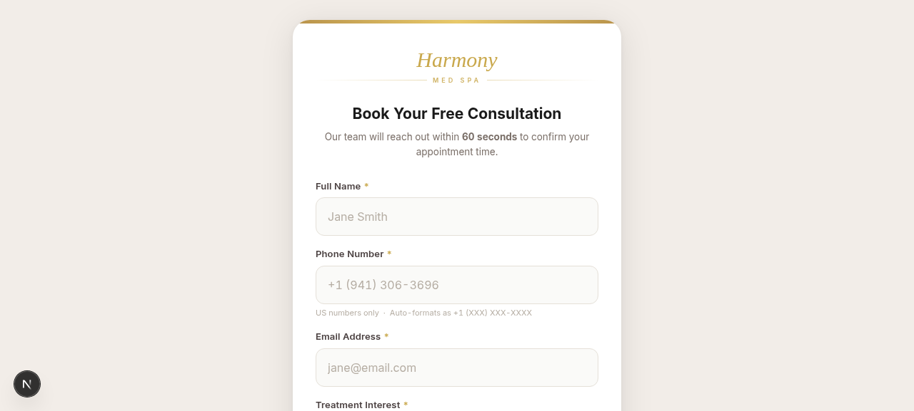

<div align="center">


<br/>

<a href="https://www.harmonymedspafl.com/"></a>
<a href="https://crm.harmonymedspafl.com/login"></a>

<br/>
<br/>

<a href="https://nextjs.org"></a>
<a href="https://react.dev"></a>
<a href="https://www.typescriptlang.org"></a>
<a href="https://tailwindcss.com"></a>
<a href="https://supabase.com"></a>
<a href="https://airtable.com"></a>
<a href="https://recharts.org"></a>


</div>

---

> **Harmony Growth Command Center** is the private, production-grade patient-growth and marketing-operations platform powering **[Harmony MedSpa](https://www.harmonymedspafl.com/)** — bringing lead management, automated nurture campaigns, Google Ads reporting & publishing, GA4 analytics, an editorial blog CMS, role-based staff access and append-only audit history into one beautiful command center.
>
> 🖥️ **Public site** → [www.harmonymedspafl.com](https://www.harmonymedspafl.com/) &nbsp;•&nbsp; 🔐 **CRM login** → [crm.harmonymedspafl.com/login](https://crm.harmonymedspafl.com/login)

---

## 📸 Inside the product

<table>
  <tr>
    <td width="50%" align="center"><strong>🔐 Secure staff login</strong><br/><br/></td>
    <td width="50%" align="center"><strong>📱 Fully responsive</strong><br/><br/></td>
  </tr>
  <tr>
    <td align="center" colspan="2"><strong>🎯 Public lead capture — feeds Speed-to-Lead in seconds</strong><br/><br/></td>
  </tr>
</table>

---

## ✨ What makes it special

| | |
|---|---|
| 🧭 **Growth Overview** | Six live KPIs (leads → contacted → replied → booked), period-over-period comparisons, sparklines, conversion funnels, and attention signals — one integration failing never erases the page. |
| ⚡ **Speed-to-Lead** | Instant SMS + email response for every new inquiry, delivery health, reply tracking, and per-lead conversation timelines. |
| 🌱 **14-Day Nurture** | A 5-step journey (Day 1 → Day 12), DST-safe New-York-time scheduling stored as UTC, bulk enrollment, CSV import, idempotency claims, and disconnected-enrollment cleanup. |
| 📣 **Google Ads workspace** | Relational drill-downs from campaigns → ad groups → ads → keywords, live inventory & status actions, AI-generated responsive-search-ad suggestions, and human-approved **paused-RSA publishing** via Make.com. |
| 📊 **GA4 website analytics** | Direct Google Analytics Data API integration — visitors, engagement, acquisition, devices, top pages, tracked streams, and hostname separation. |
| 📝 **Editorial blog CMS** | Structured blocks, FAQs, auto-generated SEO packages (Open Graph, JSON-LD, sitemap eligibility), draft → published lifecycle with manual human confirmation. |
| 🛡️ **RBAC + audit trail** | `admin` / `editor` / `viewer` roles enforced server-side on every route, append-only sanitized audit logs, and self-protection so admins can't lock themselves out. |
| 📥 **Lead operations** | Cursor pagination, full-dataset summaries, duplicate detection, delete-impact checks, filter-aware CSV export up to 10,000 rows. |
| 🌗 **Crafted UI** | Warm gold-on-stone light theme, graphite dark mode, System preference, tabular numerals, mobile cards for dense tables, reduced-motion support. |

---

## 🏗️ Architecture


**Sources of truth by design** — Airtable owns live operational & marketing data, Supabase owns identity/authorization/audit, Make.com owns external automation, Google owns reporting & execution. Secrets stay server-side; the client AuthProvider is presentation only.

---

## 🚀 Run it locally

```bash
git clone https://github.com/faisukhan01/harmonymedspa-dashboard.git
cd harmonymedspa-dashboard
bun install        # or: npm install
cp .env.local.example .env.local   # add your own credentials
npm run dev        # → http://localhost:3000
```

<details>
<summary><strong>🔑 Environment variables</strong> <em>(click to expand)</em></summary>

| Variable | Scope | Purpose |
|---|---|---|
| `NEXT_PUBLIC_SUPABASE_URL` | client | Supabase project URL |
| `NEXT_PUBLIC_SUPABASE_ANON_KEY` | client | Supabase anon key |
| `SUPABASE_SERVICE_ROLE_KEY` | 🔒 server-only | Admin operations (audit, claims, staff mgmt) |
| `AIRTABLE_API_KEY` | 🔒 server-only | Operational data store |
| `AIRTABLE_BASE_ID` / `AIRTABLE_LEADS_BASE_ID` | 🔒 server-only | Ads analytics / leads & campaigns bases |
| `ANTHROPIC_API_KEY` | 🔒 server-only | AI ad suggestions, review & post drafts |
| `NEXT_PUBLIC_MAKE_WEBHOOK_URL` | client | Public lead form → Speed-to-Lead |
| `MAKE_PUBLISH_AD_WEBHOOK_URL` | 🔒 server-only | Paused-RSA publishing (never merged with the lead webhook) |
| `REACTIVATION_UNSUBSCRIBE_SECRET` | 🔒 server-only | Signed unsubscribe links (shared with Make) |
| `GA4_PROPERTY_ID` + service-account creds | 🔒 server-only | Website Analytics workspace |
| `BLOG_REVALIDATE_SECRET` | 🔒 server-only | Public-site cache revalidation on publish |

</details>

<details>
<summary><strong>📜 Scripts</strong> <em>(click to expand)</em></summary>

| Command | What it does |
|---|---|
| `npm run dev` | Development server (Turbopack) |
| `npm run build` / `npm start` | Production build / serve |
| `npm run lint` | ESLint (next config) |
| `npm test` | Unit tests via `tsx --test` |
| `npm run seed:med-spa-pending-ads` | Seed pending ad review packages |
| `npm run import:blog-drafts` | Import the launch blog package |
| `npm run setup:calls-table` | Set up the calls table |

</details>

---

## 🛡️ Security highlights

- 🔐 **Defense in depth** — middleware session refresh → `requirePageAuth` on every protected page → `requireRole` on every API handler
- 🧱 **Fail closed** — missing configuration denies access instead of leaking data
- 🕵️ **Append-only audit log** — sanitized before/after values, email/phone masking, optional IP hashing
- ✂️ **Webhook separation** — lead intake and ad publishing can never be substituted for one another
- 🚦 **Human-in-the-loop ads** — every new ad is created *paused* and requires explicit factual approval before publishing
- 👤 **Admin self-protection** — an admin cannot demote, deactivate, or delete their own account

---

## 📂 Project structure

```text
src/
├── app/                  # App Router pages + 80+ API routes
│   ├── dashboard/        #   Growth Overview
│   ├── leads/            #   Live Airtable lead workspace
│   ├── campaigns/        #   Speed-to-Lead · 14-Day Nurture
│   ├── google-ads-analytics/
│   ├── website-analytics/
│   ├── blogs/            #   Editorial CMS
│   ├── settings/         #   Account & staff management
│   ├── audit-log/        #   Admin activity viewer
│   └── lead/             #   Public capture form
├── components/           # UI kit, charts, reactivation, nurture…
├── lib/                  # airtable · supabase · google · campaigns · leads · audit
└── contexts/             # Auth providers
supabase/                 # migrations · RLS hardening · auth setup
tests/                    # tsx unit suites for fragile business rules
docs/                     # feature deep-dives
automation/               # Make.com blueprints (Speed-to-Lead, Daily Call Import)
```

---

## 🗺️ Roadmap

- [x] Growth Overview, Leads, Campaigns, Nurture, Google Ads, GA4, Blogs, Audit, Settings
- [x] Responsive drawer navigation & reflowing mobile cards
- [ ] 💤 Dormant-patient reactivation campaigns
- [ ] 🔁 Rebooking reminders
- [ ] 🎁 Referrals & rewards
- [ ] 🤖 Broader cross-funnel AI insights center

---

## 🌐 Live

| | |
|---|---|
| 🏥 **Public website** | [https://www.harmonymedspafl.com/](https://www.harmonymedspafl.com/) |
| 🔐 **CRM dashboard** | [https://crm.harmonymedspafl.com/login](https://crm.harmonymedspafl.com/login) |

---

<div align="center">


**Crafted with ❤️ for Harmony MedSpa · Sarasota, Florida**


</div>
